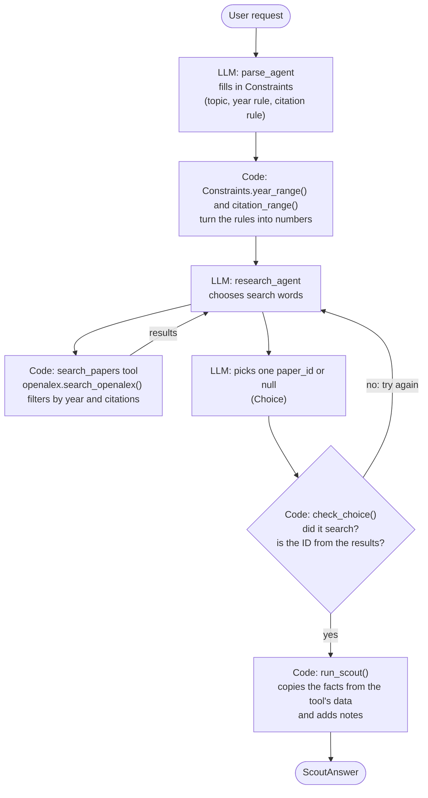

# Agent workflow

This file explains the steps the Research Scout follows to answer a request,
and which steps are done by the LLM and which by normal Python code.

The main idea: the LLM is good at understanding language and judging if a paper
is about the right topic, but it can make up facts. So the LLM only reads and
chooses. Everything that must be correct (the year and citation limits, the
title, authors, year, citation count and link in the answer) is handled by code.

All steps run inside `run_scout()` in `scout/agent.py`.

## Diagram



## Who does what

| # | Step | Done by | Where in the code |
|---|---|---|---|
| 1 | Read the user request | LLM | `parse_agent` with `parse_instructions()` in `scout/agent.py` |
| 2 | Find the constraints | LLM copies the words ("after", 2022). Code does the math ("after 2022" means 2023 or later) | `Constraints` in `scout/models.py`, `year_range()` and `citation_range()` |
| 3 | Search for papers | LLM picks the search words. Code calls OpenAlex | `research_agent` and the `search_papers` tool in `scout/agent.py`, `search_openalex()` in `scout/openalex.py` |
| 4 | Filter by year and citations | Code only. OpenAlex filters first, then Python checks every paper again | `build_filter()` and `search_openalex()` in `scout/openalex.py`, `Constraints.allows()` in `scout/models.py` |
| 5 | Decide which paper is relevant | LLM picks one paper ID, or none. Code checks the ID is real | `research_agent` (output `Choice`), `check_choice()` in `scout/agent.py` |
| 6 | Return the best match | Code copies title, authors, year, citations, source and link from the tool's data | `run_scout()` in `scout/agent.py` |
| 7 | Explain uncertainty | LLM writes what to double-check. Code adds fixed notes (assumptions, database note, missing abstract, how many searches) | `run_scout()` in `scout/agent.py` |

## Safety rules

These rules are done in code, not just asked for in the prompt, so the LLM
cannot skip them. Each one has a test in `tests/test_agent.py` that uses a fake
LLM and a fake search, so the tests need no keys and no internet.

| Rule | Where | Test |
|---|---|---|
| The LLM must search before it answers | `check_choice()` | `test_llm_must_search_before_answering` |
| A paper ID the tool never returned is rejected and the LLM must retry | `check_choice()` | `test_invented_paper_is_rejected` |
| The LLM's output has no field for title, year or citations, so facts come from the tool | `Choice` in `scout/models.py`, `run_scout()` | `test_facts_come_from_the_tool_not_from_the_llm` |
| At most 4 searches per question | `search_papers` with `config.MAX_SEARCHES` | `test_search_limit_stops_extra_searches` |
| At most 10 LLM requests in the search step | `UsageLimits(request_limit=10)` in `run_scout()` | not tested yet |
| "No paper found" is a valid answer | `run_scout()` sets `found = false` | `test_no_paper_found_is_a_valid_answer` |

## Known limits

- The `explanation` is free text written by the LLM. The prompt tells it not to
  write years or citation counts, but it sometimes still does, because the
  search results it reads include them. The real numbers in the answer always
  come from the tool's data.
- Citation counts are from OpenAlex only. Other databases (Google Scholar,
  Semantic Scholar) can show different numbers, which is why the answer always
  says where the count comes from.

## Run the tests

```
python -m pytest tests/test_agent.py
```
